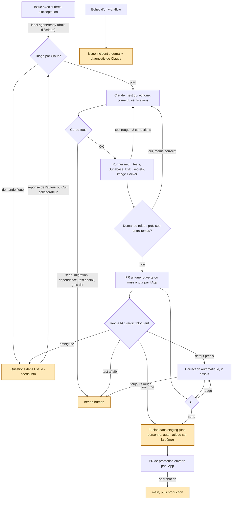

# PeopleFlow

[](https://github.com/idobeprogramming/peopleflow/actions/workflows/ci.yml)

Application de démonstration de gestion d’employés avec React, Vite, Hono et
Supabase/Postgres, livrée par un agent Claude qui transforme une issue en PR vérifiée.
L’interface est en français; le code est en anglais.

Le plan priorisé est dans [`FEATURE_PLAN.md`](./FEATURE_PLAN.md). Le processus
de travail assisté par agents est décrit dans
[`docs/agent-workflow.md`](./docs/agent-workflow.md), et des idées de démo
automatisée sont dans [`docs/agent-demo-ideas.md`](./docs/agent-demo-ideas.md).

## Démarrage

Prérequis : Node.js 22.12 ou plus récent et Docker Desktop pour la base locale
Supabase.

```powershell
npm install
npm run dev:local
```

L’interface sera disponible sur `http://localhost:5173` et l’API sur
`http://localhost:3000`. La commande applique les migrations en attente, vérifie les tables,
crée le compte de démonstration s’il manque et transmet la clé locale au processus serveur. Pour une démo en mémoire,
utilisez `npm run dev` avec les variables Supabase absentes (et `DEMO_ACCOUNT=true` dans
`.env` pour afficher le compte de démo).

## Connexion

Toute l’API exige une session, sauf `/api/health`. Compte de démonstration (fictif) :
`camille.fortin@example.test` / `PeopleFlow-Demo-2026!`. La page de connexion l’affiche
seulement si le serveur a `DEMO_ACCOUNT=true`.

- Mots de passe hachés avec scrypt (N=2^17, r=8, p=1, sel unique), comparés en temps constant
  et re-hachés automatiquement si les paramètres augmentent.
- Session : jeton aléatoire de 256 bits dans un cookie `HttpOnly`, `SameSite=Strict`,
  `Secure` et préfixé `__Host-` en production. Seul son SHA-256 est stocké; expiration 8 h;
  révoquée à la déconnexion.
- Message d’erreur unique et temps de réponse identique pour un compte inexistant;
  5 échecs par compte ou par client bloquent 15 minutes (429 + `Retry-After`).
- Écritures refusées si l’`Origin` ne correspond pas à l’hôte (CSRF); en-têtes de sécurité
  et CSP stricte sur toutes les réponses.

La clé de service reste uniquement dans l’API.

## Contribution

Suivre le fichier [`AGENTS.md`](./AGENTS.md) : une petite fonctionnalité, un
test écrit d’abord, les vérifications pertinentes, puis un commit isolé.

## Livraison depuis une issue

Une issue créée avec un modèle (Fonctionnalité ou Bogue) devient une PR vers `staging`
quand un collaborateur pose le label `agent:ready` :



Les étapes en couleur demandent une personne, sauf la fusion sur la branche de démo. Rien ne
fusionne dans `staging` ni ne part en production sans elle, et l’agent ne modifie jamais les règles qui l’encadrent (`.github/`,
`AGENTS.md`, `scripts/agent/`). Le triage lit les réponses à ses questions dans les
commentaires de l’auteur et des collaborateurs, jamais dans ceux des autres.

Une issue dont le titre commence par `[démo]` cible plutôt la branche
`demo/broken-directory-filters`, qui garde volontairement le bug des filtres pour la vidéo.

Le label `agent:ready` est l'autorisation initiale. Ensuite, une réponse de l'auteur ou d'un
collaborateur sur une issue `needs-info` relance le travail seule. `/agent update <précision>`
sur l'issue (ou `/agent fix` sur la PR), réservé au droit d'écriture, met à jour la même PR;
si elle est déjà fusionnée, l'agent propose une issue de suivi liée.

| Échec | Repris par |
| --- | --- |
| test, typage, build, migration | Claude, avec le patch et le journal, deux fois par problème (quatre par demande) |
| panne réseau ou du runner | GitHub Actions, un seul nouvel essai |
| secret, permission, SQL destructif, sécurité, cause inconnue | un mainteneur (`needs-human`) |
| comportement produit ambigu | l'auteur de l'issue (`needs-info`) | La promotion `staging → main` reste une PR approuvée.

Détails : [`docs/AUTOMATION_PLAN.md`](./docs/AUTOMATION_PLAN.md). Mise en service
(GitHub App, clés, déploiement) : [`docs/AUTOMATION_SETUP.md`](./docs/AUTOMATION_SETUP.md).

| Commande | Vérifie |
| --- | --- |
| `npm run check` | tests unitaires, typage, build |
| `npm run test:demo` | le scénario de la démo (sans dépendances) |
| `npm run test:agent` | les garde-fous et rapports de l'agent |
| `npm run test:e2e` | annuaire, création d'employé, tâche d'accueil (Playwright) |
| `npm run test:integration` | le dépôt Supabase contre la base locale (`npm run db:start`) |

Pour faire avancer plusieurs agents en local : `.\scripts\agent-worktree.ps1 -Issue 12`
crée un worktree isolé avec ses propres ports; `.\scripts\agent-cleanup.ps1` supprime
ceux dont la PR est fusionnée.

Pour tenir également le PC de démo à jour, démarrer Docker Desktop et ouvrir
PowerShell dans un clone dédié de la branche main avec accès en lecture à origin.
Lancer `.\scripts\serve-main.ps1` une fois et laisser ce terminal ouvert.
Toutes les 30 secondes le script récupère main. À chaque nouvelle version, il
relance PeopleFlow et applique les migrations locales. Une modification locale
ou une divergence suspend la synchronisation. Les journaux de l’application
sont dans `peopleflow-local.log` et `peopleflow-local-error.log`.
